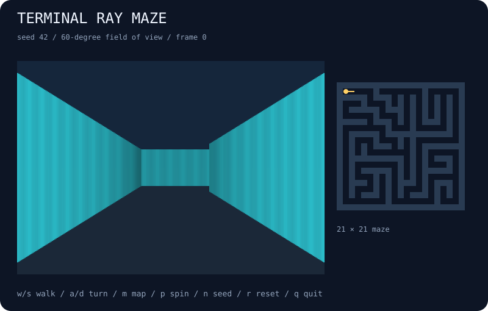

# terminal-ray-maze

Explore a seeded maze through a first-person terminal raycaster.



## Run

```bash
npx --yes github:b69ca/terminal-ray-maze
```

Node.js 20 or newer. Zero runtime dependencies. Everything runs locally.

## Play

| Key | Action |
| --- | --- |
| `p` / Space | Pause or resume automatic updates |
| `.` | Pause and advance one step |
| `n` | Start the next seed |
| `r` | Reset the current seed |
| `+` / `-` | Faster or slower display |
| `q` / Ctrl-C | Quit and restore the terminal |

`w` / `s` walk forward / backward. `a` / `d` turn. Walking or turning pauses automatic rotation; `p` resumes it. `m` toggles a top-left map overlay (clipped on grids shorter than 21 rows). SVG always includes a separate full minimap. A library `step` rotates the camera once; manual `move` and `turn` do not advance the frame count.

A live session uses an alternate screen and restores the cursor and input mode on exit. `--no-color` and `NO_COLOR=1` disable ANSI colors. Dimensions fit the terminal at startup; very small terminals may clip the minimum grid. Pass explicit dimensions to reproduce a snapshot across terminals.

## Export

```bash
npx --yes github:b69ca/terminal-ray-maze --seed 42 --steps 0 --svg preview.svg
npx --yes github:b69ca/terminal-ray-maze --seed 42 --steps 0 --json
npx --yes github:b69ca/terminal-ray-maze --frames 100
```

Common flags: `--seed N` (0–4294967295), `--width N` (40–120), `--height N` (18–60), `--steps N` (0–10000), `--frames N` (0–100000), `--json`, `--svg FILE`, `--no-color`, and `--help`.

Live mode starts at step zero. Exports and piped output default to 0 steps; `--steps` overrides that. JSON and SVG can be combined; neither accepts `--frames`. Piped output shows at most one plain frame with no ANSI escapes. Live frames show the starting state first and advance between frames; paused frames still count toward a finite frame limit. Exit codes: 0 success, 2 argument or file error.

## How it works

A seeded depth-first backtracker carves a perfect 21 × 21 maze: all passages connect, and the corridor graph has no loops. The player begins in the northwest passage looking along its first open corridor. A grid DDA raycaster finds the first wall for each screen column; a 60-degree horizontal field of view and perpendicular distance correction keep walls straight. Shading distinguishes wall faces and distance. Movement is split into small collision-tested substeps with a 0.18-cell player margin and wall sliding. Automatic steps rotate the camera in place by 0.025 radians; they do not walk or solve the maze. This is an exploration toy with no enemies, score, or win condition.

## Library

Install with `npm install github:b69ca/terminal-ray-maze`, then:

```js
import { createWorld, step, analyze, renderSVG } from 'terminal-ray-maze';
const world = createWorld({ seed: 42, width: 80, height: 30 });
step(world, 40); // Mutates and returns the world.
console.log(analyze(world));
const svg = renderSVG(world);
```

Renderers and `step` accept states created by `createWorld`. Do not change dimensions or replace internal arrays. The library also exports `move(world, distance)`, `turn(world, radians)`, and `castRay(world, angle)`.

## Development

```bash
npm ci
npm run check
```

Tests check determinism, incremental updates, model invariants, validation, rendering, CLI errors, and file exports. CI runs Node.js 20, 22, and 24.

## License

MIT
